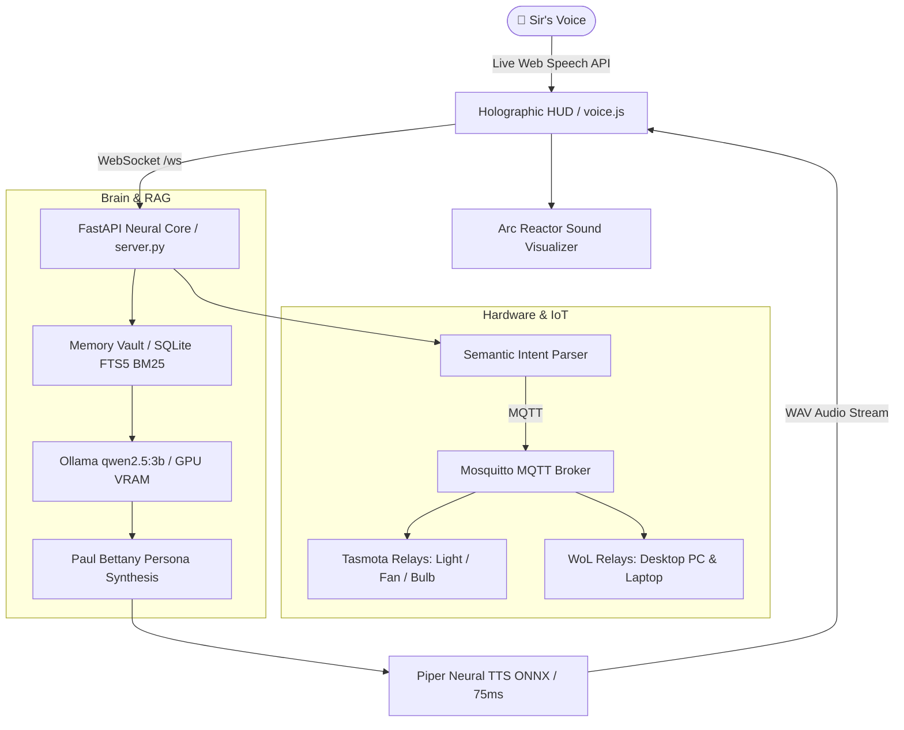

# J.A.R.V.I.S. // Stark Industries Personal AI Companion

[-00f3ff.svg)](#local-neural-brain)
[-30d158.svg)](#ultra-fast-neural-voice)
[](#real-time-rag-memory-vault)
[](#hardware--iot-infrastructure)

A personal voice AI agent modeled after **Marvel's J.A.R.V.I.S.** (voiced by Paul Bettany), engineered to serve **Sir**. Features local GPU inference, instantaneous neural speech synthesis, real-time RAG memory recall, an interactive holographic Arc Reactor HUD, and unified hardware control through iDock.

---

## 🌟 Key Capabilities

### 1. 🧠 Local Neural Brain (Zero Cloud Latency)
- **Local GPU Inference**: Powered by Ollama running on an NVIDIA RTX 3060 12GB GPU.
- **Model**: `qwen2.5:3b` (scalable to `qwen2.5:7b` or `llama3.2:3b`).
- **100% Private & Offline**: Core intelligence and telemetry stay strictly on your local machine.

### 2. ⚡ Ultra-Fast Local Neural Voice (~75ms Piper TTS)
- **Engine**: Resident in-memory ONNX neural synthesis via **Piper TTS** (`en_GB-alan-medium`).
- **Vocal Timbre**: Authentic Paul Bettany British RP cadence—poised, polite, and articulate.
- **Speed & Tuning**: Tuned with `length_scale = 0.80` and `playbackRate = 1.10x` for crisp, brisk delivery.
- **Strict Protocol**: Addressed strictly and solely as **"sir"** / **"Sir"** on every invocation.

### 3. 🔍 Real-Time RAG Memory Vault (SQLite FTS5 + BM25)
- **Instant Dual-Stream Ingestion**: Every speech input, casual thought, directive, or personal fact is recorded with human-readable timestamps.
- **Sub-Millisecond Search**: Integrated SQLite **FTS5 full-text virtual table** with BM25 relevance ranking.
- **Context Recall**: Ask anytime (*"What did I tell you about my secret project earlier?"* or *"Where did I say I might travel?"*), and J.A.R.V.I.S. searches the vault in `< 1ms` to answer with exact recall.

### 4. 🎙️ 24/7 Always-Listening with Dual Live Captions
- **Wide Wake Calls**: Responds to *"Jarvis"*, *"Hey Jarvis"*, *"Hello Jarvis"*, *"Ultron"*, and custom triggers.
- **450ms Fast-Commit**: Eliminates the 2-second cloud silence lag; commits phrases 450ms after you pause speaking.
- **Watchdog Auto-Revive**: Background heartbeat monitors microphone connection and auto-heals without UI lockups.
- **Live Dual-Channel Captions**:
  - `LIVE HEARING // SIR`: Real-time word-by-word streaming of your speech as you speak.
  - `LIVE SPEAKING // J.A.R.V.I.S.`: Dynamic highlighted words in sync with vocal audio playback.

### 5. 🌀 Holographic Arc Reactor HUD & Sound Visualizer
- **Web Audio API**: Concentric rotating rings and multi-band frequency visualizer reacting live to sound.
- **HUD States**:
  - `STANDBY`: Glowing cyan concentric idle pulse.
  - `LISTENING`: Expands rings and dynamic frequency waves bounce to your voice.
  - `THINKING`: High-speed amber orbital rotation while computing semantic actions.
  - `SPEAKING`: Resonant visualizer oscillation in sync with J.A.R.V.I.S.'s speech.
- **Stark Glass Chime**: Dual-harmonic acoustic glass tone (880Hz / 1760Hz) on wake calls.

### 6. 🏠 Hardware & Workstation Control (iDock Integration)
- **Room Fan**: *"Jarvis, turn on the fan"* / *"Kill the fan"*
- **Overhead Light**: *"Jarvis, illuminate the quarters"* / *"Turn off the light"*
- **Desk Bulb**: *"Jarvis, toggle the desk bulb"*
- **Desktop PC & Work Laptop**:
  - Multi-burst Wake-on-LAN magic packets (`UDP 192.168.1.255`, Tasmota relay, ESP32 relay, and PC Agent).
  - Suspend and sleep commands (*"Jarvis, put my PC to sleep"*).
  - Safe OS shutdown sequences (*"Jarvis, shut down the rig"*).
- **Atmosphere Scenes**:
  - *"Jarvis, engage night mode"* (Extinguishes lights, keeps fan active, suspends workstations).
  - *"Jarvis, wake all systems"* (Powers on fan, lights, and broadcasts WoL to PC & laptop).

---

## 🏗️ System Architecture



---

## 📁 Repository Structure

```
Jarvis/
├── start.sh              # 1-Click background bootstrapper
├── config.json           # Model configuration, MQTT credentials, server host
├── server.py             # FastAPI WebSocket backend & API endpoints
├── jarvis.desktop        # Linux desktop launcher shortcut
├── core/
│   ├── llm_engine.py     # Local Ollama inference orchestrator & RAG injector
│   ├── jarvis_persona.py # Marvel J.A.R.V.I.S. personality & function schemas
│   ├── tts_engine.py     # Resident Piper ONNX in-memory TTS engine (~75ms)
│   ├── semantic_parser.py# Natural language semantic intent classifier
│   ├── memory_manager.py # SQLite FTS5 BM25 RAG vault & entity extractor
│   └── idock_tools.py    # MQTT bridge for Tasmota, WoL & PC Agents
├── models/
│   └── piper/            # British ONNX voice checkpoint files
├── memory/
│   └── jarvis_memory.db  # Persistent SQLite database (FTS5 indexed)
└── web/
    ├── index.html        # Holographic Arc Reactor web dashboard
    ├── style.css         # Cyber-obsidian & Stark cyan stylesheet
    ├── visualizer.js     # Web Audio API canvas visualizer engine
    └── voice.js          # Speech recognition, watchdog heartbeat & audio pipeline
```

---

## ⚡ Quick Start

### 1. Requirements
- Linux (x86_64) or macOS with Python 3.10+
- NVIDIA GPU with CUDA support (e.g. RTX 3060 12GB) or modern multi-core CPU
- [Ollama](https://ollama.ai) installed and running:
  ```bash
  sudo systemctl enable --now ollama
  ollama pull qwen2.5:3b
  ```

### 2. Launch J.A.R.V.I.S.
Run the startup script:

```bash
cd /home/rishal/Jarvis
./start.sh
```

### 3. Open the Holographic HUD
Open your browser and navigate to:
**[http://localhost:8000](http://localhost:8000)**

- Click anywhere or press any key to grant microphone audio permissions.
- Say **"Jarvis"** or click the glowing Arc Reactor core.
- You will hear the Stark Industries glass chime, and J.A.R.V.I.S. will acknowledge: *"At your service, sir."*

---

## 🗣️ Voice Command Reference

| Intent | Spoken Variations |
| :--- | :--- |
| **Wake Call** | *"Jarvis"*, *"Hey Jarvis"*, *"Hello Jarvis"*, *"Ultron"* |
| **Room Lighting** | *"Turn on the light"*, *"Light up the room"*, *"Banish the shadows"*, *"Kill the lights"* |
| **Ventilation** | *"Turn on the fan"*, *"Spin up the blades"*, *"Turn off the fan"* |
| **Desk Bulb** | *"Turn on the desk bulb"*, *"Toggle the bulb"* |
| **Desktop Workstation** | *"Wake my desktop"*, *"Boot my PC"*, *"Put my rig to sleep"*, *"Shut down the computer"* |
| **Work Laptop** | *"Wake my laptop"*, *"Turn on the laptop"*, *"Put laptop to sleep"* |
| **Information Storing** | *"Remember that my secret project is Quantum Iron"*, *"My wifi password is stark_tech"* |
| **RAG Memory Recall** | *"What is my secret project?"*, *"What was the password I gave you earlier?"* |
| **Atmosphere Presets** | *"Engage night mode"*, *"Activate all systems"* |

---

## ⚙️ Hardware MQTT Topics

| Target | Channel / Topic | Valid Payloads | Handled By |
| :--- | :--- | :--- | :--- |
| **Room Fan** | `cmnd/room_light/POWER1` | `ON`, `OFF`, `TOGGLE` | Tasmota Relay 1 |
| **Room Light** | `cmnd/room_light/POWER2` | `ON`, `OFF`, `TOGGLE` | Tasmota Relay 2 |
| **Desk Bulb** | `cmnd/room_light/POWER3` | `ON`, `OFF`, `TOGGLE` | Tasmota Relay 3 |
| **PC Sleep / Power** | `cmnd/desktop_pc/power` | `sleep`, `shutdown` | PC Background Agent |
| **Laptop Sleep / Power** | `cmnd/work_laptop/power` | `sleep`, `shutdown` | Laptop Background Agent |
| **Wake-on-LAN** | `cmnd/room_light/WakeOnLan` | `<MAC_ADDRESS>` | Tasmota Smart Switch Relay |
| **WoL Broadcast** | `UDP 192.168.1.255:9` | Magic Packet (102B) | Local Network Broadcast |

---

## 🛡️ License

Built with pride by **Rishal** for personal workstation and workshop automation. Inspired by Stark Industries & Marvel's J.A.R.V.I.S.
